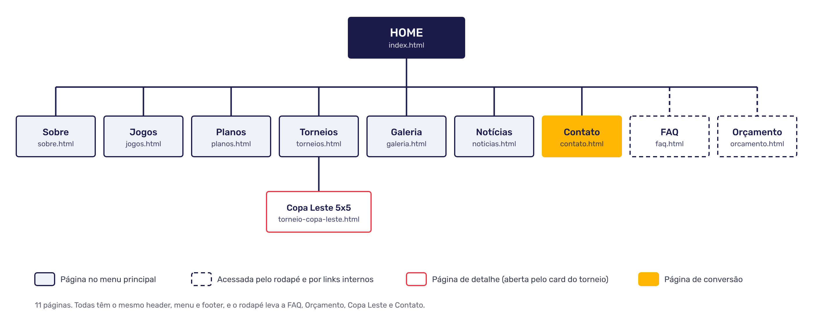

# Respawn Game House

Site de um game center fictício no Tatuapé, zona leste de São Paulo, feito como projeto da disciplina **Desenvolvimento Front-End para Web** (UNICID, Prof. Me. Gabriel Rosa Paz).



## Objetivo

Apresentar o game center Respawn, mostrar estrutura, preços e torneios, e permitir que o visitante reserve uma estação ou inscreva o seu time pelo formulário de contato.

**Público-alvo:** jovens que jogam online e querem máquina boa sem ter um PC caro em casa, times amadores de e-sports, pais procurando uma atividade segura ou festa de aniversário e estudantes da região.

## Integrante

| Nome | Curso | Papel |
|---|---|---|
| Mateus Izac Batista | Análise e Desenvolvimento de Sistemas | Projeto individual: planejamento, HTML, CSS, JavaScript, mídias, documentação e Git |

## Tecnologias utilizadas

- **HTML5 semântico:** `header`, `nav`, `main`, `section`, `article`, `aside`, `figure`, `figcaption`, `time`, `address`, `details` e `summary`
- **CSS3:** um único arquivo (`css/style.css`) com variáveis, Grid, Flexbox, `clamp()`, `clip-path` e media queries
- **JavaScript:** `js/script.js`, só para melhorar a experiência (o site funciona sem ele)
- **Multimídia:** `video` com legendas (`track`), `audio` com duas fontes (MP3 e OGG) e `iframe` com mapa
- **Git e GitHub** para versionamento, com commits por etapa

Fontes: Chakra Petch e Rubik, com licença livre (SIL Open Font License), salvas em `assets/fonts` para funcionar sem internet.

As ilustrações, a vinheta e o vídeo foram criados para este projeto. O mapa é do Google Maps.

## Páginas (11)

| Arquivo | Conteúdo |
|---|---|
| `index.html` | Página inicial com painel de estações, áreas do espaço, próximo torneio e preços |
| `sobre.html` | História, missão, visão, valores, linha do tempo e equipe |
| `jogos.html` | Configuração das máquinas e catálogo de jogos |
| `planos.html` | Planos, tabela de preços, horário e regras da casa |
| `torneios.html` | Calendário, resultados e como se inscrever |
| `torneio-copa-leste.html` | Detalhe de um torneio: resumo, regulamento e chaveamento |
| `galeria.html` | Vídeo tour com legendas e 6 imagens com legenda |
| `noticias.html` | Notícias e player de áudio com a vinheta |
| `faq.html` | Perguntas frequentes com `details` e `summary` |
| `contato.html` | **Formulário de contato** com validação nativa e mapa |
| `orcamento.html` | **Pesquisa de domínio e hospedagem** com link para o relatório |

## Estrutura do projeto

```
projeto_frontend/
├── index.html ... orcamento.html   (11 páginas)
├── css/
│   └── style.css
├── js/
│   └── script.js
├── img/
│   ├── logo.svg
│   ├── poster-tour.jpg
│   └── galeria/                    (6 ilustrações, grande e pequena)
├── assets/
│   ├── audio/                      (vinheta-respawn.mp3 e .ogg)
│   ├── video/                      (tour-respawn.mp4 e legenda .vtt)
│   └── fonts/                      (fontes e licenças)
└── docs/
    ├── README.md
    ├── planejamento_do_site.pdf / .docx
    ├── diario_de_bordo.pdf / .docx
    ├── relatorio_orcamento.pdf / .docx
    └── img/                        (sitemap e wireframes)
```

## Como abrir o site

1. Extraia o arquivo `.zip` (não abra o `index.html` de dentro do zip, senão o CSS não carrega).
2. Abra o arquivo `index.html` no navegador.

**Legendas do vídeo:** por segurança, o navegador não carrega o arquivo de legenda (`.vtt`) quando o site é aberto direto do computador (`file://`). O vídeo funciona normalmente, mas para ver as legendas abra o projeto com um servidor local:

- **VS Code:** extensão *Live Server* → botão direito no `index.html` → *Open with Live Server*; ou
- **Terminal**, dentro da pasta do projeto: `python -m http.server` e acesse `http://localhost:8000`.

## Formulário de contato

Validações nativas do HTML5 usadas em `contato.html`:

| Campo | Validação |
|---|---|
| Nome | `required`, `minlength="3"`, `maxlength="80"` |
| E-mail | `type="email"`, `required` |
| Telefone | `type="tel"`, `pattern` com DDD (opcional) |
| Assunto | `select` com `required` |
| Data | `type="date"`, `min` = hoje |
| Horário | `type="time"`, `min="10:00"`, `max="23:00"`, `step="1800"` |
| Pessoas | `type="number"`, `min="1"`, `max="20"` |
| Mensagem | `required`, `minlength="10"`, `maxlength="500"` |
| Autorização | `checkbox` com `required` |

**Não foi usada máscara dinâmica de digitação.** O `script.js` apenas:

- preenche o assunto quando o link vem de outra página (ex.: `contato.html?assunto=torneio`);
- define a data mínima como o dia de hoje;
- mostra o contador de caracteres da mensagem;
- marca os campos visitados para o CSS pintar erro (vermelho) ou acerto (verde) só depois da interação;
- mostra uma confirmação depois que todas as validações passam. Como o site é estático, nenhum dado é enviado.

Ele também abre e fecha o menu no celular e anima o painel de estações da página inicial (o painel para se o sistema pedir menos movimento).

## Validação

- **HTML:** as 11 páginas passaram no validador oficial do W3C (Nu HTML Checker, versão 26.11) **sem erros e sem avisos**.
- **CSS:** `style.css` validado no mesmo validador, sem erros.
- **Links:** 271 links e arquivos conferidos, nenhum quebrado. As 11 páginas são alcançáveis a partir do `index.html`.
- **Responsividade:** testado em 1280 px (computador) e 390 px (celular).

Para conferir online: [validator.w3.org/nu](https://validator.w3.org/nu/) (HTML) e [jigsaw.w3.org/css-validator](https://jigsaw.w3.org/css-validator/) (CSS).

## Documentação

- [Planejamento do site](planejamento_do_site.pdf): objetivo, público, sitemap, inventário, wireframes, guia visual, formulário e mídias
- [Diário de bordo](diario_de_bordo.pdf): registro das atividades
- [Relatório de orçamento](relatorio_orcamento.pdf): comparativo de domínio e hospedagem com preços reais (consultados em 14/11/2026)

**Recomendação do relatório:** domínio no Registro.br + hospedagem no Netlify, por R$ 40 por ano.

## Repositório

https://github.com/SEU-USUARIO/respawn-game-house
